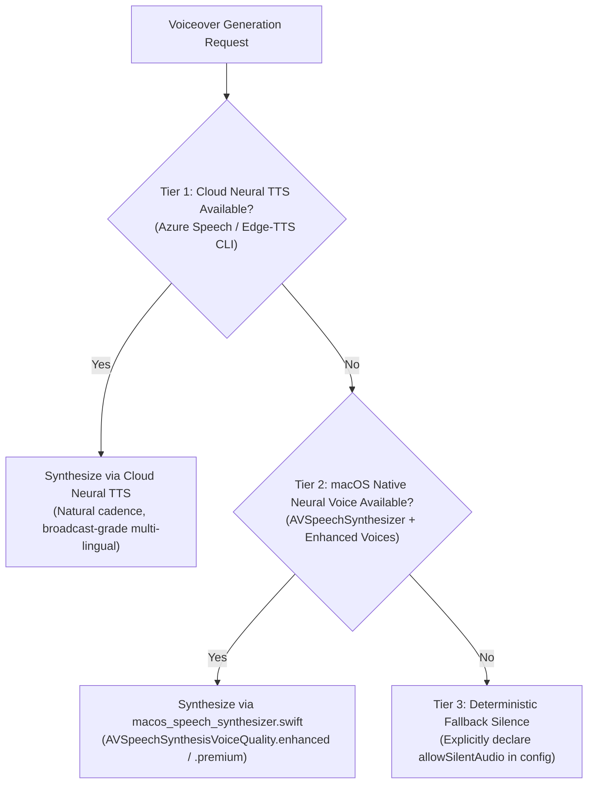

# App Store Preview Audio Standards & 3-Tier Neural TTS Architecture

This document specifies the audio engineering standards, loudness normalization, ducking mix recipes, and the 3-Tier Neural TTS hierarchy for App Store Preview videos.

---

## 1. 3-Tier Neural TTS Hierarchy

App Store Preview videos with voiceovers must never use robotic synthetic voices (e.g., legacy macOS robotic `say` voices) or raw sine-wave placeholders. Instead, voiceovers must be produced through the standard 3-tier fallback hierarchy:



### Tier 1: Cloud Neural TTS (Broadcasting Grade)
- **Engines**: Azure Neural TTS, ElevenLabs, or Zero-Key CLI (`edge-tts`).
- **Characteristics**: Studio-quality voiceover with natural prosody, high-definition neural phoneme modeling, and broad multi-lingual support.
- **Usage**: Primary voiceover pipeline when external credentials or network tools are present.

### Tier 2: macOS Native Neural Voices (`AVSpeechSynthesizer`)
- **Tool**: `runtime/scripts/macos_speech_synthesizer.swift`
- **Characteristics**: Offline, zero-network, zero-API-key linear PCM WAV rendering via `AVSpeechSynthesizer.write(_:toBufferCallback:)`.
- **Voice Selection**: Automatically selects system `AVSpeechSynthesisVoiceQuality.premium` or `AVSpeechSynthesisVoiceQuality.enhanced` neural voices installed on macOS (e.g. `Voice 1 (Aaron)`, `Voice 2 (Simone)`, `Tingting`, `Kyoko`).
- **Command Example**:
  ```bash
  swift <runtime-root>/scripts/macos_speech_synthesizer.swift \
    --text "Welcome to ParcelScope. Track all macOS installer packages cleanly." \
    --locale en-US \
    --output inputs/voiceover_en.wav
  ```

### Tier 3: Deterministic Silence / Basic Synthetic Audio
- **Characteristics**: Silent audio track (`anullsrc=channel_layout=stereo:sample_rate=48000`) or minimal sound effect beds.
- **Contract Gate**: If an App Preview video intentionally lacks commentary or music, `previewVideo.allowSilentAudio: true` must be explicitly declared in `creative.config.json` to pass the anti-silence validation gate (`mean_volume >= -80 dB`).

---

## 2. Sidechain Ducking BGM & Loudness Standards

To maintain intelligibility of feature commentary while preserving an engaging musical backdrop, previews mixing BGM and voiceover must adhere to standard ducking and loudness targets:

### 1. Sidechain Ducking Recipe (-12 dB)
When narration or sound effects play, the background music (BGM) must automatically attenuate by **12 dB** (`-12 dB` reduction) with smooth attack and release envelopes:
- **Attack Time**: 150 ms (smooth volume attenuation when voice starts)
- **Release Time**: 400 ms (smooth volume restoration when voice stops)
- **FFmpeg Filtergraph**:
  ```
  [bgm][voice]sidechaincompress=threshold=0.08:ratio=4:attack=150:release=400:level_in=1[ducked_bgm];
  [ducked_bgm][voice]amix=inputs=2:duration=longest:dropout_transition=2[mixed_audio]
  ```

### 2. Apple Broadcast Loudness Normalization (-14 LUFS)
- Integrated Loudness Target: **-14 LUFS** (ITU-R BS.1770-4 / EBU R128)
- True Peak Limit: **-1.0 dBFS** (prevents clipping during AAC transcode)
- FFmpeg Normalization:
  ```bash
  ffmpeg -i preview_mix.wav -af loudnorm=I=-14:TP=-1.0:LRA=7 preview_normalized.wav
  ```

---

## 3. Apple App Store Audio Delivery Invariants

All exported App Preview videos (`app_preview.mp4`) must conform to Apple's zero-exception media delivery rules:
- **Audio Codec**: AAC-LC (Stereo, 2 channels)
- **Sampling Rate**: Exactly **48,000 Hz** (or 44,100 Hz)
- **Bitrate**: 192–256 kbps CBR
- **Audibility Gate**: Average loudness must not be pure silence (`mean_volume >= -80 dB` verified by `validator.py`) unless `allowSilentAudio` is explicitly configured.
